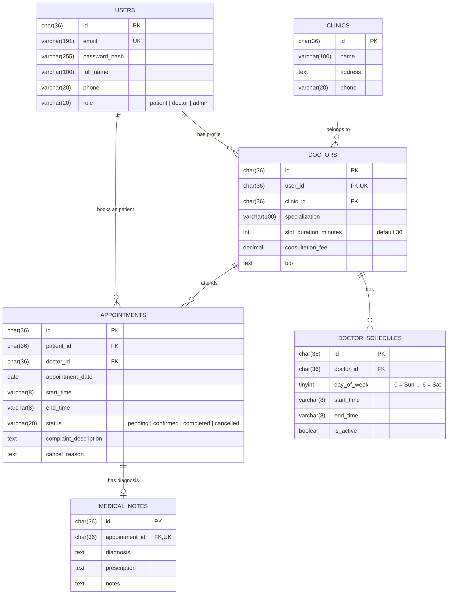

# 🏥 ClinicEase — Doctor Appointment & Clinic Booking API

[](https://golang.org)
[](https://github.com/gin-gonic/gin)
[](https://gorm.io)
[](https://mysql.com)
[](http://localhost:8080/swagger/index.html)

> A production-grade RESTful API in Go designed for clinic management and patient appointment booking with a **Zero Double-Booking Guarantee** using atomic database transactions and pessimistic concurrency locking.

---

## 🚀 Key Highlights & Engineering Features

1. **Zero Double-Booking Guarantee (Concurrency Control)**
   - Protects against simultaneous booking race conditions using atomic database transactions with pessimistic locks (`SELECT ... FOR UPDATE`) and composite unique indexes on `(doctor_id, appointment_date, start_time)`.
2. **Dynamic Slot Generation Engine**
   - Automatically computes available booking slots based on recurring doctor working schedules, doctor-configured slot duration (e.g., 30 mins), existing bookings (`pending` / `confirmed`), and real-time past slot filtering.
3. **Role-Based Access Control (RBAC)**
   - Strict segregation of permissions across **Patient**, **Doctor**, and **Clinic Admin** using JWT claims and Gin middlewares.
4. **Strict State Machine Workflow**
   - Appointments transition deterministically through:  
     $$\text{pending} \longrightarrow \text{confirmed} \longrightarrow \text{completed} \text{ or } \text{cancelled}$$
   - Includes business rules such as mandatory 2-hour advance notice for patient cancellations and medical diagnosis requirements for consultation completion.
5. **Clean Architecture (Separation of Concerns)**
   - Layered architecture (`delivery/http` $\rightarrow$ `usecase` $\rightarrow$ `repository` $\rightarrow$ `domain`) ensuring high testability, low coupling, and maintainability.
6. **Self-Documenting API**
   - Interactive Swagger OpenAPI 3.0 documentation served directly at `/swagger/index.html`.

---

## 🏛️ Architecture Overview

```
projectgo/
├── cmd/
│   └── api/
│       └── main.go                  # Dependency Injection, Migrations, Auto-Seeder
├── internal/
│   ├── config/                      # Environment and GORM database connection
│   ├── domain/                      # Domain entities, DTOs & interface contracts
│   ├── repository/                  # GORM database queries & transactions
│   ├── usecase/                     # Core business logic & validations
│   └── delivery/
│       └── http/                    # Gin HTTP Handlers, Routers & Middlewares
├── pkg/
│   ├── response/                    # Standardized API response format
│   ├── token/                       # JWT token generation & claims parser
│   └── password/                    # Bcrypt hashing & verification
└── docs/                            # Swagger OpenAPI specifications
```

---

## 🗄️ Database Schema & Relationships



---

## 🛠️ Quick Start Guide

### Prerequisites
- **Go 1.21+** installed
- **Laragon** (or local MySQL server running on `127.0.0.1:3306`)

### 1. Environment Configuration
The application automatically creates the database `clinicease_db` if it does not already exist. Verify your `.env` settings:
```env
APP_ENV=development
APP_PORT=8080
APP_NAME=ClinicEase

DB_HOST=127.0.0.1
DB_PORT=3306
DB_USER=root
DB_PASSWORD=
DB_NAME=clinicease_db

JWT_SECRET=super-secret-key-change-in-production-12345
JWT_EXPIRE_HOURS=24
```

### 2. Run the Application
```bash
go run cmd/api/main.go
```

The application will:
1. Connect to MySQL and automatically create `clinicease_db`.
2. Run GORM schema auto-migrations.
3. Automatically seed initial sample accounts (Admin, Clinic, and Doctor).
4. Start the HTTP server on port `8080`.

---

## 🔑 Pre-seeded Accounts (For Testing)

| Role | Email | Password |
| :--- | :--- | :--- |
| **System Admin** | `admin@clinicease.com` | `Admin123!` |
| **Doctor** | `doctor@clinicease.com` | `Doctor123!` |
| **Patient** | `patient@example.com` | `Password123!` |

*(New patients can also be registered directly via `POST /api/v1/auth/register`)*

## 🖥️ Web Business Portal & Dashboard

The application includes a standard enterprise clinical administration portal powered by **Tailwind CSS v3**:
👉 **[http://localhost:8080/](http://localhost:8080/)** (or `http://localhost:8080/dashboard`)

Features include:
- **Doctor Directory**: Browse medical specialists, consultation fees, and appointment durations.
- **Dynamic Scheduling**: Select dates and view available consultation hours in real-time.
- **Appointment Management**: Comprehensive ledger for patients and doctors to view, confirm, or cancel visits.
- **Clinical Encounter Notes**: Allows doctors to record diagnoses, e-prescriptions, and follow-up advice.
- **Quick Account Switcher**: Easy toggling between Patient, Doctor, and Admin accounts for testing.

---

## 📖 API Documentation & Testing (Swagger UI)

Once the application is running, open your browser and navigate to:
👉 **[http://localhost:8080/swagger/index.html](http://localhost:8080/swagger/index.html)**

### Key Endpoints Overview

#### 🔐 Authentication
- `POST /api/v1/auth/register` — Register a new patient account
- `POST /api/v1/auth/login` — Login and receive a Bearer JWT token
- `GET  /api/v1/auth/me` — Get current user profile *(Bearer Auth)*

#### 🏥 Clinics & Doctors
- `GET /api/v1/clinics` — List all clinics
- `GET /api/v1/doctors` — Search and filter doctors (supports `specialization`, `clinic_id`, `search`, `page`, `limit`)
- `GET /api/v1/doctors/:id` — View doctor profile & consultation fee
- `GET /api/v1/doctors/:id/schedules` — View doctor recurring working hours
- `GET /api/v1/doctors/:id/available-slots?date=YYYY-MM-DD` — Dynamic slot generator for a given date

#### 👨‍⚕️ Doctor Self-Service Portal *(Doctor only)*
- `GET    /api/v1/doctors/me` — Retrieve own physician profile, fees, and duration
- `PATCH  /api/v1/doctors/me` — Self-update consultation rates, duration, specialization, and clinical bio
- `GET    /api/v1/doctors/me/schedules` — List doctor's own recurring weekly consultation hours
- `POST   /api/v1/doctors/me/schedules` — Publish a new working hours slot (day of week, start/end time)
- `DELETE /api/v1/doctors/me/schedules/:id` — Remove an active consultation schedule slot

#### 📅 Appointments
- `POST  /api/v1/appointments` — Book an appointment slot *(Patient only; atomic lock)*
- `GET   /api/v1/appointments/my` — Get user's appointments (scoped by role with filters & pagination)
- `GET   /api/v1/appointments/:id` — Get appointment details (ownership-validated)
- `PATCH /api/v1/appointments/:id/confirm` — Confirm appointment *(Doctor or Admin)*
- `PATCH /api/v1/appointments/:id/cancel` — Cancel appointment *(Patient, Doctor, or Admin)*
- `POST  /api/v1/appointments/:id/complete` — Complete consultation & submit diagnosis notes *(Doctor only)*

#### 🛠️ Clinic Administration *(Admin only)*
- `POST /api/v1/admin/clinics` — Register a clinic facility
- `POST /api/v1/admin/doctors` — Unified Doctor Onboarding: creates user account (`role: doctor`) and links physician profile in a single atomic call
- `POST /api/v1/admin/schedules` — Setup doctor working hours and shift availability

---

## 🧪 Concurrency / Race Condition Handling

When multiple patients attempt to book the exact same slot concurrently:
```sql
-- Atomic check and reservation under transaction lock
BEGIN;
SELECT id FROM appointments 
WHERE doctor_id = ? AND appointment_date = ? AND start_time = ? 
  AND status IN ('pending', 'confirmed') 
FOR UPDATE;

-- If slot count > 0 -> ROLLBACK and return 409 Conflict ("SLOT_ALREADY_BOOKED")
-- Otherwise -> INSERT INTO appointments ...
COMMIT;
```

---

## 📜 License
This project is licensed under the MIT License.
